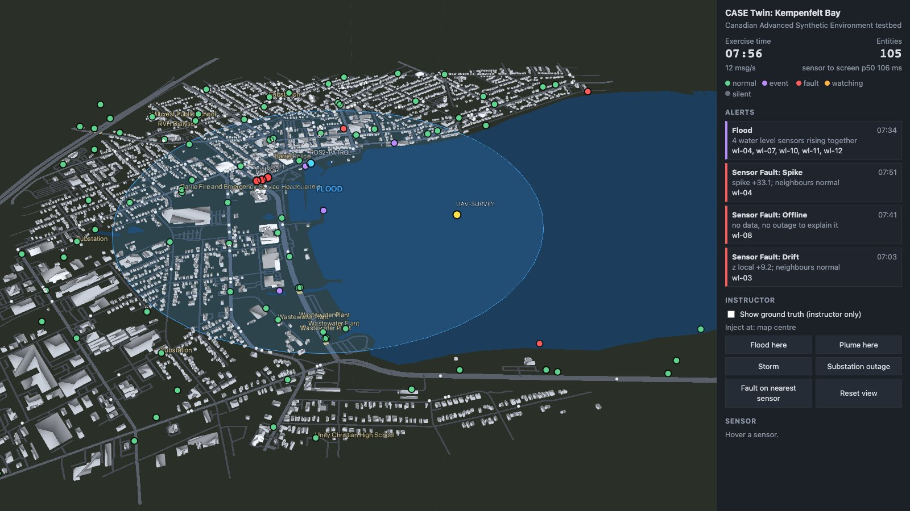

# CASE Testbed: a synthetic environment and digital twin

An interactive digital twin and distributed training environment, shaped by
the public description of National Defence's **Canadian Advanced Synthetic
Environment (CASE)** project: network-based infrastructure and processes for
distributed mission training and joint mission rehearsal. A real town built
from OpenStreetMap, simulated traffic and infrastructure sensors, floods,
plumes, storms and power cuts, a second training site joining over a WAN with
the DIS standard, a ROS 2 robot, an ESP32 field sensor, and a twin that has to
tell a broken sensor from a real emergency.

> Independent personal research by Taki Sadik. Not affiliated with, funded by,
> or submitted to DND, the CAF or any vendor. Public map data and simulated
> events only; no real exercise, site or system is modelled.
> Project page: https://tyfsadik.org/work/defence/canadian-advanced-synthetic-environment



```
SITE A                                                         SITE B
OpenStreetMap world (Barrie, ON) ─► simulation: 100 vehicles,   survey UAV, 3-vehicle convoy
95 sensors, storm/flood/plume/outage, sensor faults             ROS 2 patrol robot + DIS bridge
   │ MQTT telemetry          │ DIS v7 entity state                    │ DIS
   ▼                         ▼                                        ▼
twin backend ◄─────────────────────────────── WAN (tc netem) ─── DIS gateway
   record (SHA-256 chain) → detect (IsolationForest + spatial reasoning) → PostGIS impacts
   ▼
CesiumJS 3D viewer: live map, alerts, instructor injects, ground-truth overlay     ◄── ESP32 field node (MQTT)
```

| CASE / build need | Here |
| --- | --- |
| Virtual geographic environment from open map data | OpenStreetMap extract of downtown Barrie and Kempenfelt Bay: 3,133 buildings, 109 km of roads, 5 bridges, 3 substations, civic assets |
| Virtual sensors, vehicles, infrastructure | 95 sensors (water level, air quality, traffic, bridge strain, weather, substation load) driven by 100 simulated vehicles and the environment |
| Environmental events | storm, flood, Gaussian air plume, substation outage, from a scenario file or live instructor injects |
| Distributed mission training network | two sites, DIS (IEEE 1278.1) entity state with dead reckoning, a site gateway, WAN latency and loss |
| Stream to the backend, show it in 3D | MQTT and DIS into FastAPI, PostGIS, WebSocket to a CesiumJS viewer |
| AI anomaly detection | IsolationForest per sensor type plus spatial reasoning: sensor fault or real event |
| Mission rehearsal and review | instructor injects, ground-truth overlay, hash-chained recording that replays to identical alerts |
| ROS 2 | a ROS 2 Jazzy patrol robot bridged into the DIS exercise |

## Results (final rehearsal)

Exercise 1 (four simulated hours, 11 injected sensor faults, 4 real events) at
20x real time in Docker, scored against the simulator's ground truth:

| | Twin | Naive per-sensor detector |
| --- | --- | --- |
| Alerts an operator sees | 19 | 53 |
| Sensor faults confirmed | 10 of 11, median 3 min | 9 of 11, median 5 min |
| Events recognised (storm, flood, plume, outage) | 4 of 4, median 4 min | 0 of 4 |
| False fault alerts | 0 | 4 |
| Real events blamed on sensors | 0 | 36 |

* The spoofed gauge (replaying pre-flood readings in the middle of the flood) was caught in 60 s; the eleventh fault, a slow 8 ug/m3-per-hour drift, was flagged "unexplained, watching" after 42 min but not confirmed before the exercise ended.
* Same results on four traffic/noise seeds. On **held-out exercise 2** (different places, wind, substation and faults, never used for tuning): 10 of 10 faults (9 of 10 before one rule added after seeing it), 3 of 4 events, 0 false fault alerts, 0 events blamed on sensors; the naive detector raised 68 alerts. The missed plume blew away from the sensors: its largest effect was +7 ug/m3 at one sensor.
* **Replay:** the 466,497-record recording verifies (SHA-256 chain) and replays in 13.9 s to the identical 143 alert changes, in order.
* **Impacts from PostGIS:** the flood's shoreline footprint held 206 buildings, 10.8 km of road and the police station when it opened; the outage cut a substation serving 598 buildings including the fire headquarters.
* **Latency:** sensor to backend 1.3 ms median (3.8 ms p95); sensor to a WebSocket subscriber 7.9 ms median (25 ms p95) in real time.
* **Instructor inject:** a plume released at the police station became a plume alert 177 s later (real time).
* **Bandwidth:** dead reckoning sent 360,256 entity-state PDUs for 100 vehicles over four hours, 75% fewer than one per vehicle per second.
* **Hardware path:** the field node's messages (stand-in in the rehearsal) registered on the map and were stored in PostGIS as hardware.

Site B across the WAN, 60 s per condition (mean position error on the twin):

| WAN (one way, gateway to twin) | UAV PDUs/s | UAV: last report / dead reckoning from receipt / from PDU timestamp | Convoy: receipt / timestamp | ROS 2 robot: timestamp |
| --- | --- | --- | --- | --- |
| LAN | 0.4 | 37.48 m / 0.15 m / **0.07 m** | 0.14 m / **0.14 m** | 0.04 m |
| 50 ms | 0.54 | 32.02 m / 1.01 m / **0.15 m** | 0.71 m / **0.27 m** | 0.07 m |
| 150 ms | 0.56 | 31.17 m / 2.79 m / **0.24 m** | 1.69 m / **0.25 m** | 0.07 m |
| 300 ms | 0.56 | 34.46 m / 5.52 m / **0.35 m** | 0.84 m / **0.3 m** | 0.04 m |
| 150 ms, 2% loss | 0.56 | 39.63 m / 2.78 m / **0.24 m** | 1.66 m / **0.4 m** | 0.07 m |
| 150 ms, 0.25 m threshold | 0.99 | 29.22 m / 2.77 m / **0.09 m** | 1.28 m / **0.16 m** | 0.04 m |
| 150 ms, 3 m threshold | 0.38 | 33.7 m / 2.93 m / **0.63 m** | 1.72 m / **1.16 m** | 0.04 m |

The UAV flies at 18 m/s. Dead reckoning from the moment a PDU arrives loses
speed x latency (5.5 m at 300 ms); extrapolating from the PDU's own timestamp
cancels the WAN, which needs synchronised clocks between sites. A tighter
threshold buys accuracy with bandwidth (0.25 m: 0.99 PDU/s for 0.09 m; 3 m:
0.38 PDU/s for 0.63 m). The convoy stops at a scene for 40 s each lap, so its
numbers depend on where in the lap the window fell.

Everything the runs found and fixed: [docs/04-findings.md](docs/04-findings.md).

## Quick start

```bash
./local/rehearse.sh up      # open http://127.0.0.1:8000 (site A at 20x)
./local/rehearse.sh test    # about 45 minutes; results/rehearsal
python tools/offline.py     # the whole exercise in one process, about 2 minutes
```

## Docs

1. [Physical setup](docs/01-physical.md): ESP32 field node, two sites, a real ROS 2 robot
2. [Deploy](docs/02-deploy.md): settings, two machines, Proxmox, writing a scenario
3. [Before anything real](docs/03-production.md)
4. [What the rehearsal found](docs/04-findings.md)
- [Architecture reference](docs/architecture.md)

## Repository map

```
case/        world builder, traffic, physics, sensor faults, DIS, detector, pipeline, scoring
services/    site A sim, site B federates, DIS gateway, twin backend + 3D viewer, ROS 2 robot + bridge
hardware/    ESP32 field node (MicroPython)
scenarios/   exercise 1 (tuning) and exercise 2 (held out)
stacks/      docker compose, images, broker config
tools/       offline run, scoring, replay, WAN matrix, dead-reckoning analysis, viewer check
local/       the rehearsal
results/     rehearsal runs and offline runs
world/       OpenStreetMap extract and its query
```

Map data (c) OpenStreetMap contributors, ODbL 1.0. Code: MIT licence.
